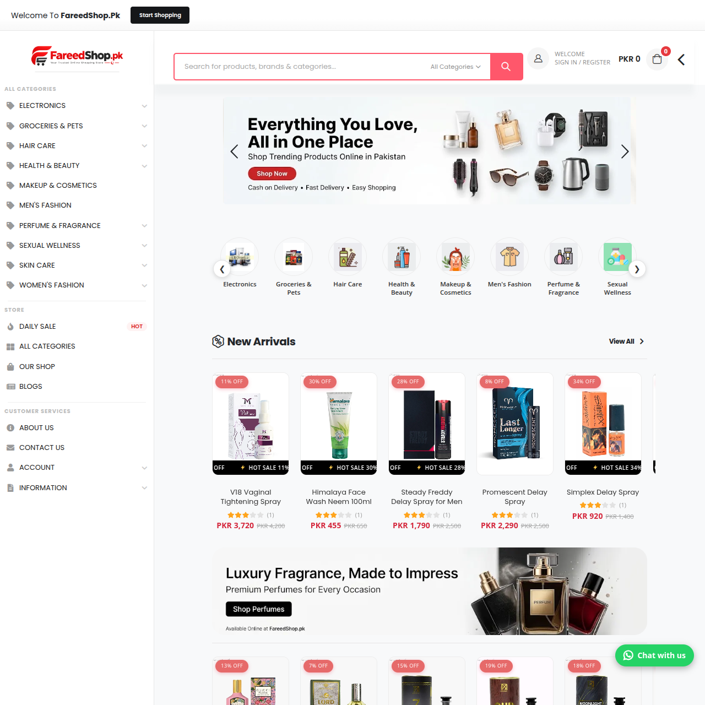
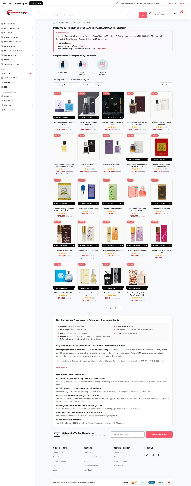
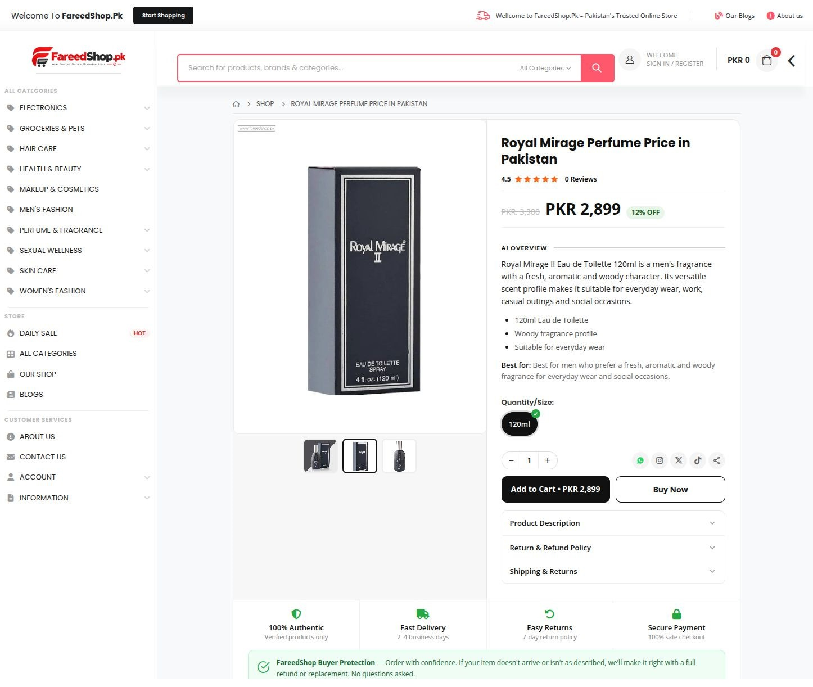

# FareedShop.pk – Online Shopping in Pakistan

  

<h3 align="center">Your Online Shopping Destination in Pakistan</h3>

  Discover Beauty, Skincare, Perfumes, Fragrances, Fashion & More.

  <a href="https://www.fareedshop.pk/"><strong>Visit Live Website →</strong></a>

---

## About FareedShop.pk

**FareedShop.pk** is an online shopping platform in Pakistan, designed to provide customers with convenient access to a diverse range of products across multiple categories.

From skincare and beauty essentials to perfumes, fragrances, fashion and everyday shopping, FareedShop.pk brings different shopping categories together in one online destination.

Our focus is on an accessible shopping experience, organized product collections and a user-friendly website interface.

## Website Preview

  

## Featured Categories

  

- Health & Beauty
- Skincare Products
- Perfumes & Fragrances
- Fashion & Lifestyle
- Hair Care
- Everyday Essentials
- New Arrivals
- Daily Deals

## Featured Product Showcase

  

## Key Website Features

- Modern and user-friendly shopping interface
- Responsive website experience
- Product listings and detailed product pages
- Organized shopping categories
- Product search and discovery
- Shopping cart functionality
- Wishlist functionality
- New Arrivals collection
- Daily Deals and promotional products
- Beauty and fragrance collections
- Product pricing and availability information

## Technology Stack

| Technology | Purpose |
|---|---|
| Laravel | Backend Framework |
| PHP | Server-side Development |
| MySQL | Database |
| HTML5 | Website Structure |
| CSS3 | Styling |
| JavaScript | Interactive Features |
| Bootstrap | Responsive Interface |

## Brand Identity

  

**Brand:** FareedShop.pk  
**Website:** https://www.fareedshop.pk/  
**Market:** Pakistan  
**Category:** E-commerce /[ Online Shopping](https://imtiazcenter.pk/)

## Connect With FareedShop.pk

- **Official Website:** https://www.fareedshop.pk/
- **GitHub Organization:** https://github.com/fareedcenterpk

---

  <strong>FareedShop.pk</strong> 
  Online Shopping in Pakistan
    
  © 2026 FareedShop.pk. All Rights Reserved.

